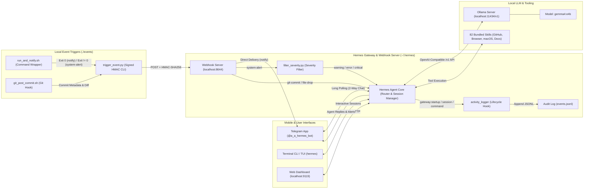
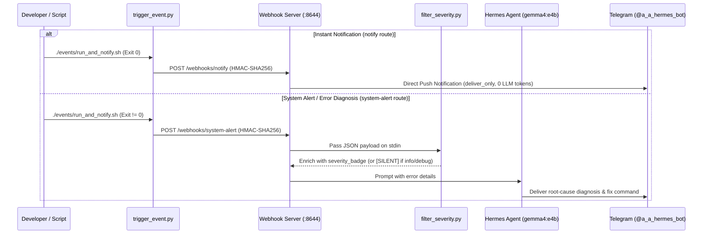

# Hermes Local AI & Event-Driven Automation Workspace

A local AI assistant and event-driven automation suite powered by **Nous Research Hermes Agent**, running locally on **Ollama (`gemma4:e4b`)** and connected to **Telegram (`@a_a_hermes_bot`)**.

---

## 🏗️ System Architecture



---

## 🔄 Event-Driven Execution Flow



---

## 📁 Repository Structure

```text
hermes/
├── readme.md                   # Architecture overview and quickstart guide
├── hermes-wiki.md              # Full reference documentation for Hermes Agent
├── install_hermes_agent.sh     # Installer script for Nous Research Hermes Agent
├── events/
│   ├── trigger_event.py        # HMAC-SHA256 webhook client for port 8644
│   ├── run_and_notify.sh       # Wraps commands: notifies on success, diagnoses on error
│   ├── git_post_commit.sh      # Git post-commit hook for AI commit reviews on Telegram
│   ├── filter_severity.py      # Webhook severity filter (mirrored in ~/.hermes/scripts/)
│   └── activity_logger.py      # Gateway lifecycle hook (mirrored in ~/.hermes/hooks/)
└── tests/
    └── test_events.py          # Unit test suite (10 tests covering all event components)
```

---

## 🚀 Quick Start

### 1. Chat with Hermes (`gemma4:e4b`)
```bash
# Terminal REPL / TUI
hermes
hermes --tui

# Or message @a_a_hermes_bot directly on Telegram
```

### 2. Trigger Event-Driven Actions to Telegram
```bash
# Send an instant push notification to @a_a_hermes_bot:
python3 events/trigger_event.py notify -d '{"title": "Deployment Ready", "message": "v1.2.0 is live"}'

# Run any command and get notified (or AI-diagnosed if it fails):
./events/run_and_notify.sh pytest

# Attach AI commit reviews to any Git repository:
ln -sf /Users/jerry/Documents/antigravity/hermes/events/git_post_commit.sh /path/to/repo/.git/hooks/post-commit
```

### 3. Run Unit Tests
```bash
python3 -m unittest discover -s tests -v
```
